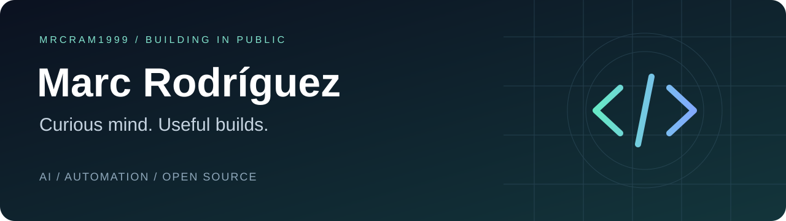

<h1 align="center">Hey, I'm Marc 👋</h1>

<strong>Turning “what if?” into something you can use.</strong>

AI experiments · Practical automation · Open-source tools

---

### 🛠️ What I'm building

I like projects that solve a real annoyance: fewer repetitive tasks, less friction, and more control over the technology we own. This is where I build, test and share those ideas.

**[CleanMyXiaomi →](https://github.com/Mrcram1999/CleanMyXiaomi)**  
An AI-guided project for Xiaomi, Redmi and POCO: inspect your phone, understand the proposed changes, and keep a way back. Audit first. Explicit consent. No root.

> Early alpha: auditing is available. Real-device cleanup profiles still need testing and review.

### 🔎 Things I'm exploring

| AI that does useful work | Technology you control | Building in public |
| --- | --- | --- |
| Agents and practical workflows | Android, privacy and reversible changes | Small tools, clear docs and honest limitations |

### 👋 También en castellano

Soy Marc. Me interesan los proyectos que convierten una idea curiosa en algo útil: automatizar tareas, experimentar con IA y recuperar el control de nuestros dispositivos.

Aquí comparto lo que voy construyendo, con sus avances y sus límites. Si tienes una idea o encuentras algo que mejorar, abre una issue en el proyecto correspondiente.

---

Build something useful. Explain it clearly. Keep improving.

